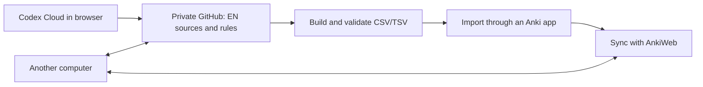

# EN cloud authoring and Anki handoff

Prepared October 27, 2026. Read this file with `AGENTS.md` after extracting the
handoff ZIP. It records the working card system and the cloud design discussed
with the learner; it does not imply that the cloud system has been deployed.

## 1. What the learner wants

Maintain the same personal English cards from different computers, and ideally
from a browser conversation. The assistant should be able to read the current
card sources, explain and consolidate proposed additions, make approved edits,
run the existing builders, and provide validated Anki import files.

The learner wants this handoff to let a new Codex session catch up without the
original chat. They may first discuss the design, or ask that session to begin
implementing it through Codex Cloud. Follow their new request; the current
task was packaging, not creating a GitHub repository or deploying a service.

## 2. Verified snapshot

| Component | Current state |
| --- | --- |
| Vocabulary master | 321 entries: 243 ACTIVE, 76 RECEPTIVE, 2 SKIP |
| Vocabulary import | 319 notes; SKIP entries are not exported |
| Production patterns | 329 notes: 320 production frames and 9 operation-based grammar cards |
| Connection patterns | 603 validated notes in nine numeric subdecks |
| Correction registry | 100 canonical records; separate from the Anki decks |
| Latest approved batch | 63 new notes: 57 vocabulary and 6 production patterns; 6 existing notes revised |
| Latest batch import into the learner's Anki app | Not performed or verified in the originating session |
| Original personal-chunks shortlist | Deleted as requested after successful card builds; it is not a current source |
| GitHub repository / Codex Cloud environment / Actions workflow | Not configured by the originating session |
| GitHub and Notion integrations | Found as available options; no connection was confirmed |
| EN maintenance skill | Proposed, not implemented or installed |

These counts describe this snapshot. Recalculate after future edits instead of
treating them as permanent targets. The portable checks and latest batch
evidence are in `scripts/verify_handoff.py` and `handoff/last_card_update/`.

## 3. Source ownership

| Family | Editable source | Generated import | Governing instructions |
| --- | --- | --- | --- |
| Vocabulary | `cards/vocabulary/data/vocabulary_master.csv`, maintained through structured update JSON and the updater | `cards/vocabulary/exports/anki_import.csv` | `cards/vocabulary/CARD_AUTHORING.md` and `cards/vocabulary/README.md` |
| Production patterns | `cards/patterns/cards.md` | `cards/patterns/anki-import.tsv` | `cards/CARD_AUTHORING.md`, `cards/patterns/PATTERN_FRAME_SELECTION.md` |
| Connection patterns | Nine numbered Markdown sources and `inventory-slices/*.tsv` under `cards/connections/` | `cards/connections/coverage.tsv` and `cards/connections/anki-import.tsv` | `cards/CONNECTION_DECK_PLAN.md`, `cards/connections/README.md` |
| Corrections | `cards/corrections/data/correction_master.json`, maintained through its script | No separate Anki deck | `cards/corrections/README.md` |

Vocabulary is not a Markdown-only system. Keep its master CSV, structured
updates, templates, styling, and scripts together. Do not hand-edit generated
exports or replay historical update batches to reconstruct an already complete
master; replaying them can increment encounter counts or restore older content.

The old preposition plan, inventory, pilot, and reviews are retained as migration
evidence. The current connection deck owns the final export. Do not build a
second standalone preposition deck.

`AGENTS.md` contains the learner's English-teaching and approval conventions.
Read the relevant authoring specification before card work. In particular:

- Prefer American English; preserve natural wording and useful distinctions.
- Compare new material with all relevant existing card families by meaning.
- Variants of one expression usually belong together, while familiar grammar
  does not make an unfamiliar lexical meaning redundant.
- Explain and classify bare lists before Anki edits. Honor explicit approval
  when given; do not ask for the same approval again.
- Use each family's existing visible card format and build procedure.
- Correction tracking does not automatically authorize Anki-card creation.
- Read the omission-card specification before any omission/shortening work.
  The latest batch left all nine such cards unchanged.

## 4. What is in this package

The package preserves the relative `EN/` layout and includes:

- Current card sources, generated imports, templates, tools, authoring guides,
  coverage inventories, review evidence, and vocabulary update history.
- The correction registry and its maintenance script.
- Lightweight grammar and Cambridge Markdown references used by the existing
  card documentation. They are reference material, not additional decks.
- The latest batch's implementation manifest and complete resulting Fronts
  and Backs, under `handoff/last_card_update/`.
- This design, a short package README, a portable verifier, and file checksums.

It excludes Git metadata, machine-specific agent configuration, credentials,
caches, old backups, scratch directories, textbook PDFs, audio, page images,
and the actual Anki collection database. It therefore does not contain Anki
review history or prove that the newest imports are already installed.

Some textbook Markdown references point to excluded page images or audio.
Do not reconstruct damaged exercises from those transcriptions alone. Attach
the original source media if a future study task needs it. Those media are not
required to rebuild the card imports.

## 5. First steps after extraction

Open a terminal inside the extracted `EN` directory. Use Python 3.10 or newer.
The included card builders and validators use the Python standard library;
no third-party package installation or API credentials are required for them.

```bash
python3 scripts/verify_handoff.py --check-snapshot
python3 scripts/verify_handoff.py --rebuild
```

On Windows, `py -3` can replace `python3` if that is how Python is installed.
The verifier uses its own Python interpreter for child commands and derives
paths from its location; no original computer path is required.

`--check-snapshot` checks the original packaged file hashes as well as the
current card contracts. Use it before editing. After intentional edits, use
the verifier without that flag; snapshot hashes are an archive-integrity
check, not a rule that source files must never change.

The default mode checks that current generated imports agree with the current
sources. `--rebuild` first rebuilds the three imports and connection coverage,
then performs the same checks. Neither mode upserts vocabulary encounters,
records corrections, promotes proposed content, or changes source card content.

Existing family commands remain authoritative:

```bash
python3 cards/vocabulary/scripts/update_vocabulary.py validate
python3 cards/tools/build_import.py --self-test
python3 cards/tools/build_import.py
python3 cards/tools/build_connection_coverage.py --check
python3 cards/tools/promote_connection_cards.py --check
python3 cards/tools/build_connection_import.py --final --check
python3 cards/corrections/scripts/update_corrections.py validate
python3 cards/corrections/scripts/update_corrections.py self-test
```

After editing connection content or inventory, follow that family's complete
README workflow. Mechanical promotion does not replace linguistic review.

### Known unrelated audit problem

The original `scripts/audit.py` expects an obsolete top-level `chapters/`
layout and does not properly handle encoded spaces in some reference links.
It failed before this handoff. It remains included as historical workspace
tooling, not as a passing card-release check. Do not report a full workspace
audit pass based only on successful card builders. Repairing the broad grammar
audit is separate work unless the learner includes it in the new task.

## 6. Recommended cloud architecture

This is the preferred starting design from the discussion, open to revision.



### GitHub: authoritative authoring files

Put the card-authoring workspace, rules, templates, scripts, and eventually its
skill in one private repository. Keep edits and derived imports together so
the current validated downloads are available from any computer. Avoid
duplicating the authoritative card data in another independently editable
store. The package `.gitignore` excludes local state and scratch artifacts.

Syncing the repository does not sync review progress. Use the learner's AnkiWeb
account for the Anki collection. On a new computer, sync the existing collection
from AnkiWeb before importing updates; this source package is not a substitute
for that collection or its scheduling history.

### Codex Cloud: browser-based edits and execution

Connect the chosen GitHub repository to a Codex Cloud environment with Python
available. A browser task should be able to inspect the sources, make approved
content changes, run the actual family builders, and produce a reviewable diff
and validated imports. Save accepted changes back to the repository so future
tasks start from them; an unsaved task workspace is not the source of truth.

Do not assume an ordinary ChatGPT chat has repository write access and a Python
runtime just because a GitHub app is connected. Verify the tools and account
capabilities in that environment. The originating session did not test a cloud
environment or connected GitHub write operation.

### GitHub Actions: optional automatic build and downloadable files

After the repository exists, a workflow can run the same Python checks for
proposed changes and publish a CSV/TSV bundle. This needs no LLM API call for
the deterministic build itself. Scope the workflow to card contracts rather
than the known-failing legacy grammar audit.

Files committed with the source are durable repository outputs. Workflow
artifacts have retention limits; do not make an expiring artifact the only
copy of the current imports. A stable download from repository files or a
release can be considered later. Nothing in this handoff configures Actions.

### Notion: optional study inbox

Notion's integration can read, create, and update pages when the connected
client exposes those tools. It can be convenient for collecting expressions,
study notes, and proposed cards during normal ChatGPT conversations.

For this existing system, treat Notion as optional input rather than replacing
the CSV/Markdown sources. Turning Notion pages into validated Anki imports
would require a conversion/build bridge. Do not silently implement two-way
Notion/GitHub editing or claim that this bridge already exists.

### The remaining Anki step

Generating a TSV or CSV in the cloud does not itself update AnkiWeb. The
documented workflow imports cards through an Anki client and then syncs to
AnkiWeb. A fully browser-only publishing path would require a separately
designed, authenticated, and tested import/sync integration. Do not promise
direct AnkiWeb file import based on GitHub or Notion access alone.

## 7. Existing-note identity and review-history protection

Current text imports match existing notes using their first regular note field:

- Vocabulary: `Term` with the `EN_Vocabulary` note type (the name used in the learner's collection).
- Production and connection notes: `Front` with the appropriate Basic note
  type and import matching settings. The TSV Deck column is routing metadata,
  not an extra visible note field.

Updating the matched existing note preserves its scheduling. Renaming a Term
or Front can create another note instead. Removing a source row does not by
itself delete its old counterpart in Anki. Preserve identity during ordinary
Back edits and use an explicit migration plan for renames, merges, or removals.
Do not delete and recreate notes as a routine update strategy.

Stable internal source IDs plus a mapping to Anki-assigned GUIDs are a possible
future improvement for renames. They are not implemented. Such a migration
must reconcile the learner's real collection before changing exports, preserve
the required two visible fields on pattern/connection notes, and avoid inventing
replacement Anki GUIDs for notes that already exist.

## 8. Suggested implementation sequence

1. **Establish the portable baseline.** Run the included verifier, inspect the
   current sources, and identify which machine or cloud environment is active.
2. **Choose the first usable workflow.** The simplest starting point is a private
   GitHub repository, Codex Cloud editing, and manual Anki import/sync. Confirm
   account access and the intended repository before external operations.
3. **Create the EN maintenance skill if requested.** A suggested repo-local path
   is `.agents/skills/en-maintainer/SKILL.md`. Keep it compact: discover the EN
   root, route to the existing authoring guides, check semantic duplication,
   perform approved changes, and run the correct builders. Do not copy all the
   authoring specifications into the skill or depend on personal memory files.
4. **Add cloud build automation.** Reuse the existing validators or the portable
   verifier; provide clear downloadable outputs and actionable failure reports.
5. **Consider convenience integrations.** Add a Notion inbox or a custom
   ChatGPT connector only if the learner wants them. A skill teaches procedure;
   it does not grant storage, repository write access, or an execution runtime.
6. **Address identity migration and automatic Anki publishing separately.** Use
   the learner's actual collection for verification; current exports alone do
   not contain the real note GUIDs or review history.

The new user request determines implementation scope. Finish the authorized,
reviewable local work before asking for any genuinely missing external
authorization. Do not create public repositories, push files, connect accounts,
or deploy services solely because this design lists them as possible steps.

## 9. Acceptance criteria for a future cloud implementation

- A new browser task can access the latest approved sources and authoring rules.
- Approved edits rebuild the appropriate import files and pass family checks.
- Changes are visible in a diff and saved to the chosen repository.
- The learner can download the validated imports from another computer.
- Updates to existing notes retain their intended identity and review history
  when tested in the learner's Anki collection.
- A new computer gets study progress through AnkiWeb, not through Git or this ZIP.
- No status message claims a remote upload, Anki import, skill installation, or
  deployment without evidence that it happened.

## 10. Suggested prompt for the next Codex session

```text
Read AGENTS.md and design.md in this extracted EN workspace. Run
python3 scripts/verify_handoff.py --check-snapshot, then explain what already
works and which parts of the cloud design are still proposals. Use the local
files as evidence and preserve the existing card formats and data. Help me
decide the next step; if I ask you to implement it, carry out that scope and
show the resulting changes and validation. Do not assume any GitHub, Notion,
Codex Cloud, or Anki account connection is already configured.
```

## 11. External references from the discussion

These document capabilities, not proof of access on the learner's account.
Recheck availability and permissions when configuring the actual services.

- [Codex Cloud](https://learn.chatgpt.com/docs/cloud)
- [Repo-local skills](https://learn.chatgpt.com/docs/build-skills#where-codex-loads-local-skills)
- [ChatGPT plugins and skills](https://developers.openai.com/training/walkthroughs/plugins-and-skills)
- [GitHub Actions artifacts](https://docs.github.com/en/actions/tutorials/store-and-share-data)
- [Notion MCP tools](https://developers.notion.com/guides/mcp/mcp-supported-tools)
- [Anki import matching and scheduling](https://docs.ankiweb.net/manual/importing/text-files#duplicates-and-updating)
- [AnkiWeb sync](https://docs.ankiweb.net/manual/syncing)
- [Anki collection packages and backups](https://docs.ankiweb.net/manual/exporting)
- [Anki's client/import/sync workflow](https://docs.ankiweb.net/manual/getting-started#shared-decks)
